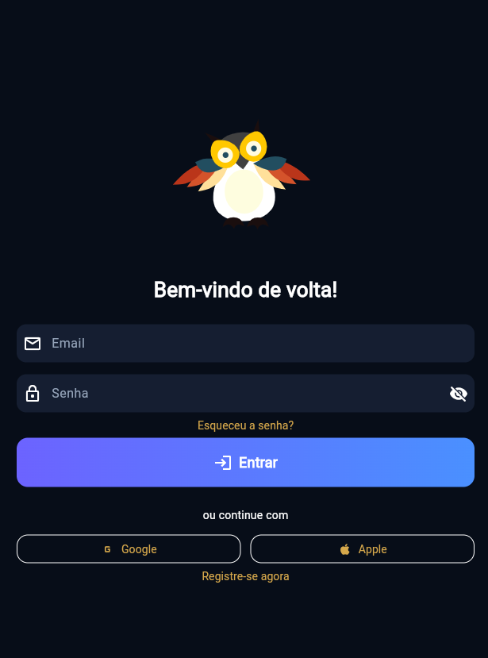
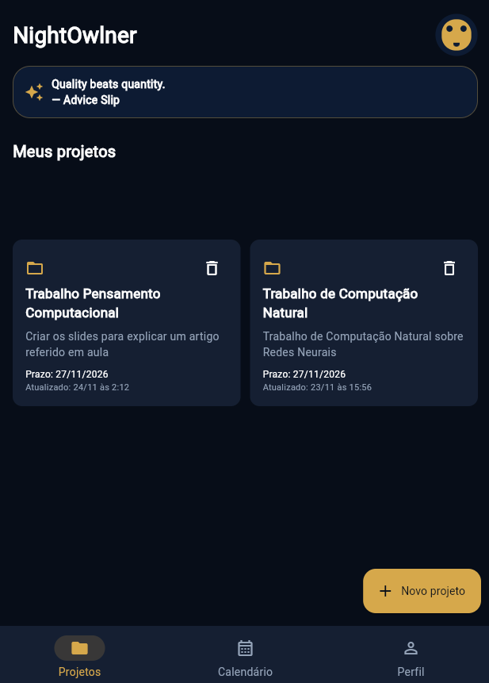
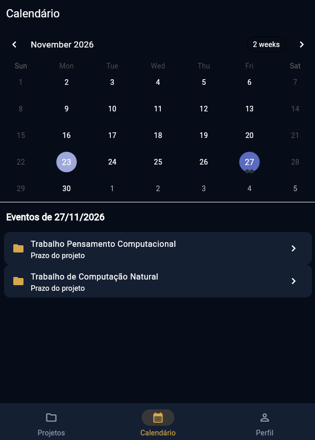

# NightOwlner

Aplicativo Flutter para organização de projetos acadêmicos, tarefas, prazos e localização.

## Integrante

- **Giulia Mezaroba** - [giuliamezaroba@gmail.com](mailto:giuliamezaroba@gmail.com)

## Objetivo

O NightOwlner tem como objetivo ajudar estudantes a organizar projetos acadêmicos e acompanhar suas tarefas e prazos em um único aplicativo. A solução reúne autenticação, persistência de dados, calendário, imagens dos projetos, localização e frases motivacionais em uma interface com tema escuro.

## Tecnologias utilizadas

- Flutter
- Dart
- Firebase Authentication
- Cloud Firestore
- Firebase Storage
- Material 3

## Bibliotecas utilizadas

- `firebase_core`: inicialização e integração com o Firebase.
- `firebase_auth`: cadastro, login, recuperação de senha e logout.
- `cloud_firestore`: persistência de projetos e tarefas.
- `provider`: gerenciamento de estado com `ChangeNotifier`.
- `table_calendar`: calendário com marcadores de tarefas.
- `geolocator`: obtenção da localização atual após ação do usuário.
- `image_picker`: seleção de imagens dos projetos.
- `lottie`: exibição de animações.
- `http`: consumo de APIs externas.
- `image`: processamento de imagens.
- `fake_cloud_firestore`: suporte aos testes do Firestore.

## Funcionalidades implementadas

- Cadastro, login, recuperação de senha e logout.
- Criação, edição, visualização e exclusão de projetos.
- Criação, edição, conclusão e exclusão de tarefas.
- Organização de tarefas por projeto e prazo.
- Calendário com marcadores reais de tarefas.
- Upload de até cinco imagens por projeto no Firebase Storage.
- Exibição da localização atual mediante solicitação do usuário.
- Frase motivacional usando ZenQuotes, com fallback para Advice Slip e frase local.
- Interface com tema escuro baseado no Material 3.

## Imagens das principais telas

As imagens devem ser adicionadas na pasta `docs/screenshots/`. Para incluir um print:

1. Crie a pasta `docs/screenshots/` na raiz do projeto, caso ela ainda não exista.
2. Salve os arquivos nessa pasta com nomes simples, por exemplo `login.png`, `projetos.png` e `calendario.png`.
3. Adicione as imagens ao README usando o caminho relativo:

```md



```

Exemplo de organização:

```text
docs/
└── screenshots/
	├── login.png
	├── projetos.png
	└── calendario.png
```

## Instruções para executar

### Pré-requisitos

- Flutter instalado e configurado.
- Um dispositivo Android, iOS ou emulador disponível.
- Projeto Firebase configurado com Authentication, Cloud Firestore e Firebase Storage.

### Execução

```sh
flutter pub get
flutter run
```

O projeto já utiliza as configurações existentes em `lib/firebase_options.dart` e `android/app/google-services.json`.

### Validação

```sh
flutter test
flutter analyze
flutter build apk --debug
```

## Firebase

O arquivo `firebase.json` referencia as regras do Cloud Firestore. Configure no Firebase Console os serviços de Authentication, Cloud Firestore e Firebase Storage antes de executar a aplicação.

As regras limitam leitura e escrita ao usuário proprietário dos dados em `users/{uid}` e `projects/{uid}/{projectId}/images`.

## Estrutura principal

- `lib/models`: entidades e serialização.
- `lib/repositories`: Firestore, Storage, localização e APIs externas.
- `lib/providers`: estado reativo com `ChangeNotifier`.
- `lib/view`: telas e formulários.
- `lib/components`: widgets reutilizáveis.
- `test`: testes de modelos, repositórios, providers e formulários.
